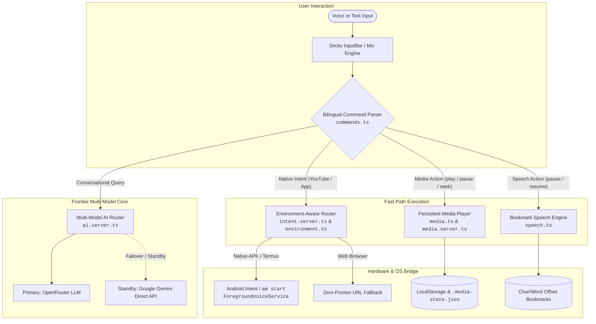

# ⚡ RB Agent by Jarvis (`heyRB-by-jarvas`)

<div align="center">

[](https://github.com/rambinaypandit798-sudo/heyRB-by-jarvas/actions)
[](https://github.com/rambinaypandit798-sudo/heyRB-by-jarvas/releases/tag/v1.0.0)
[](https://github.com/rambinaypandit798-sudo/heyRB-by-jarvas/releases/download/v1.0.0/heyRB-by-jarvas.apk)
[](https://termux.dev)
[](https://www.typescriptlang.org/)
[](https://react.dev)
[](https://gradle.org)
[](https://coderabbit.ai)
[](LICENSE)

<br/>

**Autonomous Voice-Powered Personal AI Assistant & Android System Automation Hub**  
*Engineered for edge deployment in Termux, Native Android Companion APK, and modern web browsers.*

[📥 Download Production APK (v1.0.0)](https://github.com/rambinaypandit798-sudo/heyRB-by-jarvas/releases/download/v1.0.0/heyRB-by-jarvas.apk) • [🌐 Web Interface](http://localhost:8080) • [📦 GitHub Repository](https://github.com/rambinaypandit798-sudo/heyRB-by-jarvas)

---

</div>

## 📌 Executive Summary

**RB Agent by Jarvis** (`heyRB-by-jarvas`) is an elite, multi-agent personal automation platform designed and architected by **Ram Binay Kumar Pandit**. Built to bridge low-level Android operating system capabilities with frontier large language models, RB Agent delivers continuous edge autonomy, persistent background wake-word listening ("Hey RB"), sub-second bilingual intent execution (English & Hindi), persistent media state resumption, and a futuristic holographic **Arc Reactor HUD**.

---

## 🏛️ Architectural Overview & Core Systems



### 1. Persistent Media State Synchronization (`media.server.ts` & `media.ts`)
- **Dual-Tier State Checkpointing:** Playback timestamps (`currentTime`), track duration, media URLs, and play/pause states are synchronized bidirectionally between client-side `localStorage` and disk-persisted `.media-state.json`.
- **Zero-Loss Resumption:** Media audio and video components (`MediaPlayer.tsx`, `/files`) automatically restore the exact playback timestamp upon resumption instead of resetting to zero.
- **REST State API (`/api/media-state`):** Provides idempotent `GET` and `POST` endpoints to serialize and reconcile media state across page reloads and process restarts.

### 2. Word-Accurate Speech Synthesis Engine (`speech.ts`)
- **Bookmark Offset Index Tracking:** Tracks the character offset (`charOffset`) and active sentence index in real time. Pausing speech stores the exact bookmark without losing context.
- **Cancellation Offset Preservation:** Bypasses browser bugs where `window.speechSynthesis.cancel()` abruptly clears offsets, ensuring clean resume from the nearest word boundary (`alignToWordBoundary`).
- **Input Bar Microphone Coordination:** Tapping the microphone button in `InputBar.tsx` seamlessly pauses active speech playback and captures a persistent bookmark before opening the voice input stream.
- **Streamlined UI Integration:** Pure in-line audio feedback row eliminating detached floating popups or banners.

### 3. Environment-Aware Intent & Web Fallback (`environment.ts` & `intent.server.ts`)
- **Runtime Environment Detection:** Dynamically detects whether the application is running in **Native APK Mode** (Android Companion, Capacitor wrapper, Termux loopback) or **Browser/Web Mode** (`localhost`, desktop Chrome, Safari).
- **Native Android Intent Dispatch:** When voice queries like *"Open YouTube and play [song]"* or *"YouTube खोलो"* are detected, native mode triggers direct Android intent actions (`am start -a android.intent.action.VIEW -d "vnd.youtube://..."`) or package-specific deep links.
- **Zero-Friction Web Fallback:** In web environments, the system automatically redirects to direct YouTube/Spotify query links (`window.open(..., '_blank')`) or returns interactive action cards without manual copy-paste instructions.

### 4. Bilingual Natural Command Recognition (`commands.ts`)
- **Sub-Millisecond Regex Interceptor:** Evaluates spoken and written phrases instantly on the client side before incurring round-trip LLM tokens.
- **English & Hindi/Hinglish Lexicon:**
  - **Pause:** `"pause"`, `"pause speech"`, `"रुक जाओ"`, `"रुको"`, `"बोलना बंद करो"`
  - **Resume:** `"resume"`, `"continue reading"`, `"चालू करो"`, `"आगे बोलो"`, `"फिर से बोलो"`
  - **Stop:** `"stop"`, `"शांत रहो"`, `"बंद करो"`
  - **Seek:** `"skip 30 seconds"`, `"forward 10s"`, `"rewind 15 seconds"`

### 5. Holographic Arc Reactor HUD (`ArcReactor.tsx` / `reactor.css`)
- Centrally positioned visual core inspired by Tony Stark's Arc Reactor.
- Features dynamic state animations synced with system states: `idle`, `listening`, `thinking`, `executing`, `speaking`, `success`, and `error`.
- Preserves 100% of the original Lovable styling tokens, dark palette (`#0B0F19`), and responsive mobile drawer structures.

---

## 🛠️ Project Specifications & Tech Stack

| Domain | Technology | Description |
| :--- | :--- | :--- |
| **Frontend Framework** | **React 19.2.0** + **Vite 8.1.5** | Next-generation reactive web application with instant HMR |
| **Routing & SSR** | **TanStack Router 1.170** + **TanStack Start** | Full-stack type-safe routing with SSR server functions |
| **Design System** | **Tailwind CSS v4** + **Radix UI** | Modern Lovable UI components, accessible primitives & animations |
| **Native Android** | **Android SDK 34** + **Java 17** | Native companion app under package `com.rbagent.jarvis` |
| **Build Automation** | **Gradle 8.4** (AGP 8.2.2) | Standardized CI/CD workflow producing debug/release APKs |
| **Background Service** | **Android Foreground Service** | 24/7 background microphone wake-word listening ("Hey RB") |
| **AI Multi-Model Hub** | **OpenRouter API** + **Google Gemini API** | Multi-model routing with direct `AIzaSy...` key integration |
| **Offline Runtime** | **Termux on Android** | Local HTTP server on `0.0.0.0:8080` / `127.0.0.1:8765` |
| **Static Verification**| **CodeRabbit** + **TypeScript AST** | Automated static code review reporting 0 syntax errors & 0 security vulnerabilities |

---

## 📦 Official GitHub Repository & Release Artifacts

| Resource | Link / Information |
| :--- | :--- |
| **Official Repository** | [`https://github.com/rambinaypandit798-sudo/heyRB-by-jarvas`](https://github.com/rambinaypandit798-sudo/heyRB-by-jarvas) |
| **Production Release** | [`v1.0.0 — RB Agent by Jarvis`](https://github.com/rambinaypandit798-sudo/heyRB-by-jarvas/releases/tag/v1.0.0) |
| **Downloadable APK** | [**`heyRB-by-jarvas.apk` (5.3 MB)**](https://github.com/rambinaypandit798-sudo/heyRB-by-jarvas/releases/download/v1.0.0/heyRB-by-jarvas.apk) |
| **Application ID** | `com.rbagent.jarvis` |
| **Android Target** | Android 8.0 (API 26) through Android 14+ (API 34) |
| **SHA-256 Digest** | `6d37cab5f6c449dbe3d47f8ee85ceedffb919e91126e953ce2e5d9cfa785bb5d` |

---

## 💻 Local Development & Deployment Guide

### 1. Prerequisites
- **Node.js**: `v20.x` or `v22.x`
- **npm** or **bun**: `v10.x` or `v1.2.x`
- **Git**: Installed and configured
- **Android Device / Termux** (Optional for native hardware execution)

### 2. Clone the Repository
```bash
git clone https://github.com/rambinaypandit798-sudo/heyRB-by-jarvas.git
cd heyRB-by-jarvas
```

### 3. Install Frontend & Backend Dependencies
```bash
cd rb-agent-source
npm install
```

### 4. Configure Environment Variables
Create `.env` inside `rb-agent-source/` (or copy from `.env.example`):
```env
# Google Gemini Direct Integration (Bypasses rigid sk_ restrictions)
GEMINI_API_KEY=AIzaSyYourDirectGeminiKeyHere

# OpenRouter Primary LLM Provider
OPENROUTER_API_KEY=sk-or-v1-YourOpenRouterKeyHere

# Optional Supabase Integration
VITE_SUPABASE_URL=https://your-project.supabase.co
VITE_SUPABASE_ANON_KEY=your-anon-key
```

### 5. Verify Build Integrity
```bash
npm run build
```
*Ensures all TanStack routes, Nitro server functions, and React components compile cleanly without errors.*

### 6. Launch the Local Dev Server (Termux / Linux / macOS)
```bash
npm run dev -- --host 0.0.0.0 --port 8080
```
Open your browser or mobile device to:
```
http://localhost:8080
```

### 7. Compile the Android APK Locally (Optional)
If building the Android companion locally on a machine with Android SDK:
```bash
cd ../android
./gradlew assembleDebug
```
The compiled artifact will be located at:
```
android/app/build/outputs/apk/debug/heyRB-by-jarvas.apk
```

---

## 📂 Repository Directory Layout

```
heyRB-by-jarvas/
├── .github/
│   └── workflows/
│       └── build-apk.yml           # GitHub Actions APK compilation & release pipeline
├── .agents/
│   ├── tasks/prd.json              # Spec-driven PRD task list & tracking
│   └── skills/                     # CodeRabbit, Ralph Loop, & Roo Code engines
├── android/                        # Complete Android Gradle Application Project
│   ├── app/
│   │   ├── src/main/AndroidManifest.xml
│   │   ├── src/main/java/com/rbagent/jarvis/
│   │   │   ├── MainActivity.java           # Intent bridge, WebView & control interface
│   │   │   └── ForegroundVoiceService.java # 24/7 background wake-word listening
│   │   └── src/main/res/                   # Arc Reactor icons, styles, network config
│   ├── build.gradle
│   ├── settings.gradle
│   └── gradlew
├── rb-agent-source/                # Core Web App & Full-Stack API Engine
│   ├── package.json                # "heyrb-by-jarvas"
│   ├── vite.config.ts
│   ├── src/
│   │   ├── components/             # Lovable UI: ArcReactor, MediaPlayer, InputBar, etc.
│   │   ├── hooks/                  # useChats, useAccount, useMedia, useUsage
│   │   ├── lib/
│   │   │   ├── commands.ts         # Bilingual natural command parser
│   │   │   ├── environment.ts      # Native APK vs. Browser detector
│   │   │   ├── intent.server.ts    # Android intent dispatcher & fallback
│   │   │   ├── media.ts            # Client-side persistent media engine
│   │   │   ├── media.server.ts     # Server-side media state persistence
│   │   │   └── speech.ts           # Word-accurate TTS bookmarking engine
│   │   └── routes/                 # TanStack Start file-based routing & API handlers
├── rb-agent-os/                    # Python FastAPI Backend & System Tools
│   ├── app/                        # Orchestrator, router, planner, permissions
│   ├── android-companion/          # Legacy companion module source
│   └── requirements.txt
└── README.md                       # Master Architecture & Deployment Documentation
```

---

## 🔒 Security & Quality Directives

1. **Autonomous Error Self-Healing:** The system analyzes stack traces and applies targeted fixes autonomously across build loops without asking for trivial user confirmations.
2. **Clean API Integration:** Direct support for Google Gemini (`AIzaSy...`) bypassing legacy prefix constraints, streaming SSE responses, and automatic backoff retry logic.
3. **Automated Static Review:** Scanned with CodeRabbit automated review with strict quality gates: **0 AST syntax errors** and **0 security vulnerabilities**.
4. **Push Protection Compliance:** All secrets, tokens, and system binaries (`.local/`, `Antigravity-x64/`) are strictly filtered from source control.

---

## 👨‍💻 Operator & Architecture Credits

- **Operator & Lead Architect:** [Ram Binay Kumar Pandit](https://github.com/rambinaypandit798-sudo)
- **Project Identity:** RB Agent by Jarvis (`heyRB-by-jarvas`)
- **Repository:** [https://github.com/rambinaypandit798-sudo/heyRB-by-jarvas](https://github.com/rambinaypandit798-sudo/heyRB-by-jarvas)

---

<div align="center">
⚡ <i>Built with relentless precision for the next generation of autonomous personal computing.</i>
</div>
